# ShopEasy

An e-commerce shopping website built with React, Vite, and Supabase.

ShopEasy is a React + Vite storefront using Supabase Auth and PostgreSQL. The
application includes the shop, size-aware product variants, a persistent user
bag, COD checkout, customer order tracking/cancellation, and an administrator
workspace. The SQL files must be applied to the Supabase project before the
commerce features can access data.

## Technology

- React + Vite (JavaScript) and React Router
- Supabase Auth and PostgreSQL
- Row Level Security (RLS) and PostgreSQL functions for data protection and
  transactional commerce operations
- Supabase publishable/anon key in the browser; no service-role key

## Architecture

The browser application uses `@supabase/supabase-js` directly. Supabase Auth
handles identities and sessions; Supabase PostgREST provides the table API;
PostgREST RPC invokes database functions for cart changes, checkout,
cancellation, administrator checks, and status updates. There is no custom
Express.js server or separate ShopEasy API service. PostgreSQL RLS and function
checks—not hidden frontend routes—enforce access to customer and administrator
data.

The application currently requires sign-in before the home page, catalogue, or
product pages are available.

## Prerequisites

- Node.js `^20.19.0` or `>=22.12.0` (required by the installed Vite 8 release)
- npm
- A Supabase project for Auth and PostgreSQL
- Optional: Postman to exercise the documented Supabase API calls

The current repository has no automated test or type-check script. Use the
lint and production build commands below, then follow the customer/admin test
flows after configuring a development Supabase project.

## Deploy to Netlify

1. Push the project to GitHub, then in Netlify choose **Add new site → Import
   an existing project** and connect the `Im-Ariyan/ShopEasy` repository.
2. Configure the site build:
   - Build command: `npm run build`
   - Publish directory: `dist`
   - Base directory: leave blank
3. In **Site configuration → Environment variables**, add:
   - `VITE_SUPABASE_URL` — your Supabase project URL
   - `VITE_SUPABASE_ANON_KEY` — your Supabase publishable/anon key

   Use the public publishable/anon key only. Never add a database password or
   service-role key. These `VITE_` values are included in the browser build.
4. In Supabase **Authentication → URL Configuration**, set **Site URL** to your
   deployed Netlify URL (for example, `https://your-site.netlify.app`). Add that
   URL and `https://your-site.netlify.app/**` to **Redirect URLs**. Keep
   `http://127.0.0.1:5173` and `http://127.0.0.1:5173/**` too for local
   development. If you add a custom domain, add it there as well.
5. Trigger a Netlify deploy. The `public/_redirects` file lets React Router
   routes such as `/admin`, `/orders`, and `/products` work when opened or
   refreshed directly.

Each deployment uses the Supabase project configured by its own environment
variables. The live project's database and configuration have not been
inspected. Netlify hosts the frontend; it does not host or replace the
Supabase database.

## Local setup and database configuration

1. Copy `.env.example` to `.env`, then add the Supabase project URL and public
   publishable (or legacy anon) key as `VITE_SUPABASE_URL` and
   `VITE_SUPABASE_ANON_KEY`. These values are included in the browser build.
   Never put a database password or service-role/secret key in a frontend
   variable.

   Example values only:

   ```dotenv
   VITE_SUPABASE_URL=https://your-project-ref.supabase.co
   VITE_SUPABASE_ANON_KEY=your-supabase-publishable-or-anon-key
   ```
2. For a **clean development database**, choose exactly one database setup
   path:

   - **Migration path (recommended):** In the Supabase SQL Editor, apply
     `supabase/migrations/202610180001_is_shop_admin.sql`,
     `supabase/migrations/20261018000200_shopping_schema.sql`,
     `supabase/migrations/202610180003_wishlist.sql`, and
     `supabase/migrations/202610220001_auto_order_progression.sql`, in that
     order.
   - **Consolidated schema path:** Apply `supabase/schema.sql` to a clean
     development database instead of applying the four migration files. This
     is a submission snapshot of those migrations; it was not run against or
     compared with the live database.

   Do not apply the consolidated schema and the same migrations to the same
   database. The auto-progression migration requires `pg_cron` to be available
   and permitted in the target Supabase project. Never use the consolidated
   submission schema as an unreviewed live-database migration.
3. After creating the schema in a clean development project, run
   `supabase/seed.sql` to add seven sample categories, products, and variants.
   The seed uses `ON CONFLICT DO NOTHING`; it does not update or delete
   conflicting catalogue data. Keep production data out of development tests.
4. In **Authentication → URL Configuration**, set the local URL as described
   under Supabase Auth settings below.
5. Install and run the app from the repository root:

   ```powershell
   npm ci
   npm run lint
   npm run build
   npm run dev -- --host 127.0.0.1
   ```

   Vite prints the local address when the dev server is ready.

## Submission documentation

- [Submission audit](./docs/SUBMISSION-AUDIT.md) — repository findings and
  verification boundaries.
- [API documentation](./docs/API-documentation.md) — verified Supabase Auth,
  PostgREST, and RPC operations; no custom Express routes are claimed.
- [Postman collection](./docs/postman/ShopEasy.postman_collection.json) and
  [Postman environment template](./docs/postman/ShopEasy.postman_environment.json)
  — fill in credentials locally and use a development project.
- [ER diagram](./docs/ER-diagram.mmd) — Mermaid relationships for the
  repository-defined database tables.
- [`supabase/schema.sql`](./supabase/schema.sql) — consolidated copy of the
  checked-in migrations for clean development/submission review.
- [`supabase/seed.sql`](./supabase/seed.sql) — repeatable sample catalogue
  seed; apply only after setting up the schema.

## Screenshots

The supplied application captures are stored locally so these README images do
not depend on the external image host. Personal profile values and order details
visible in the supplied captures have been redacted. See the
[screenshot checklist](./screenshots/README.md) for the remaining views that
still need capturing.

### Home and collections

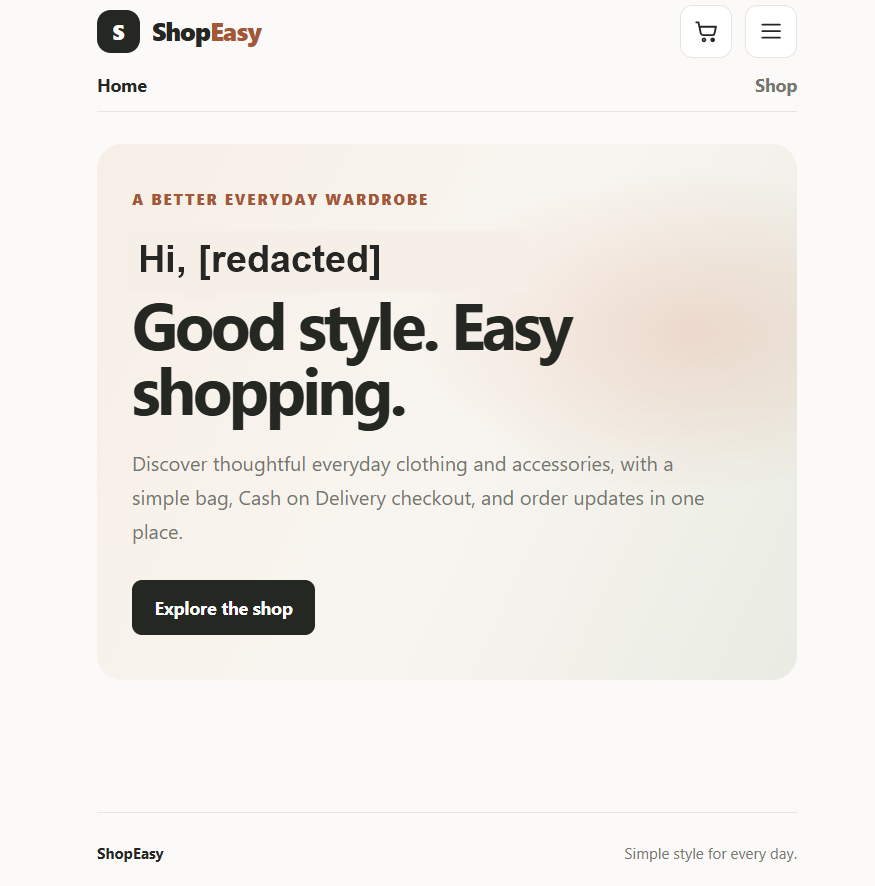

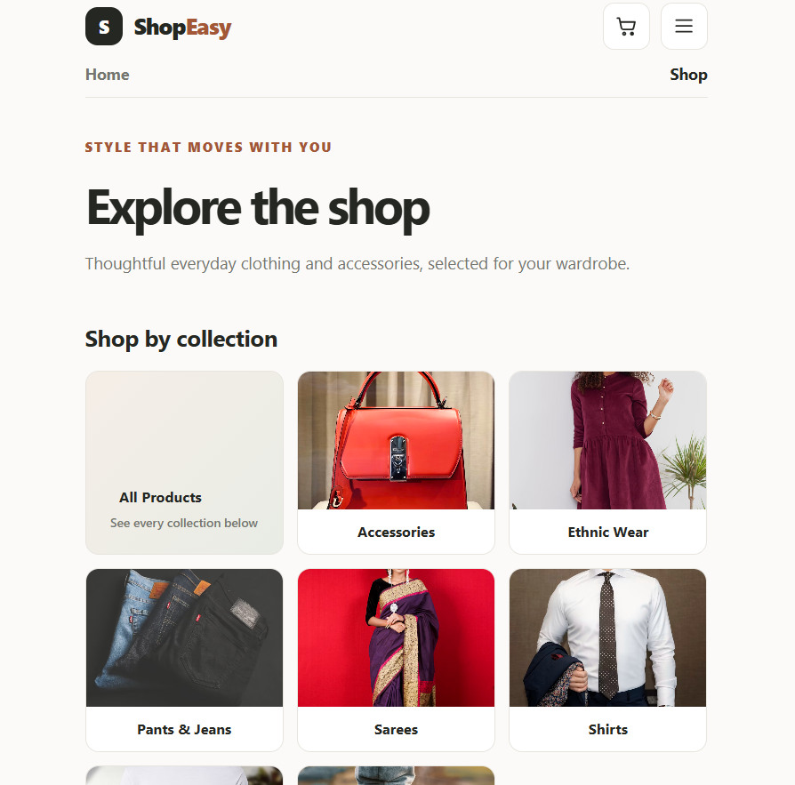

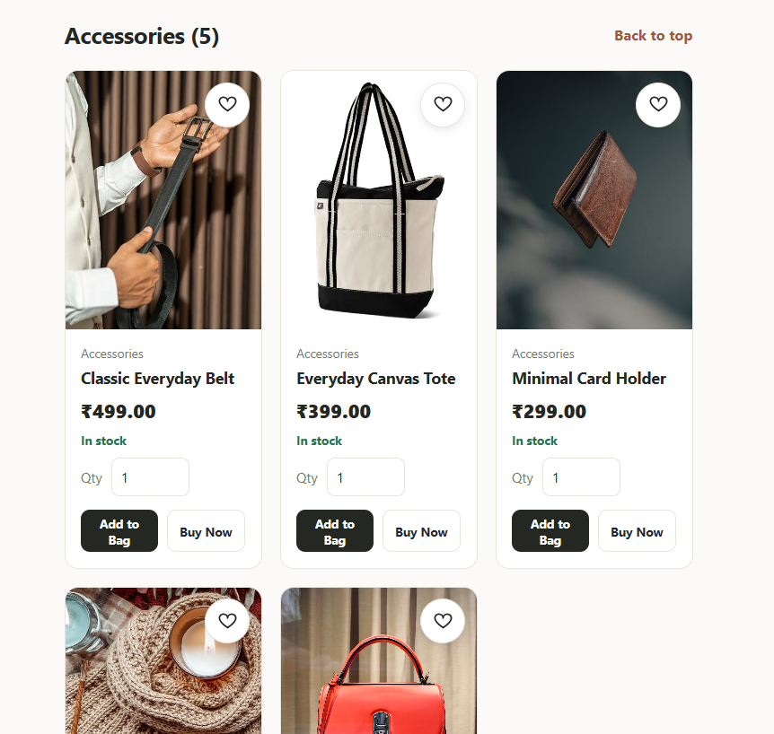

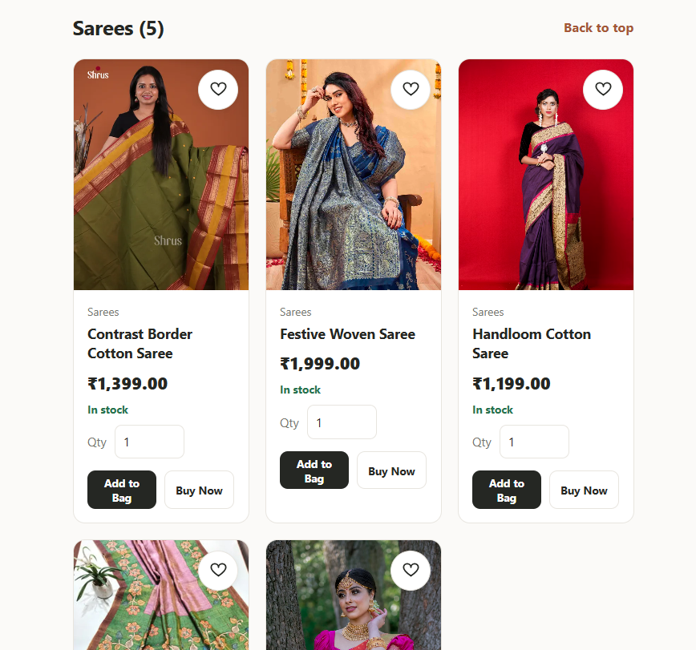

### Customer account

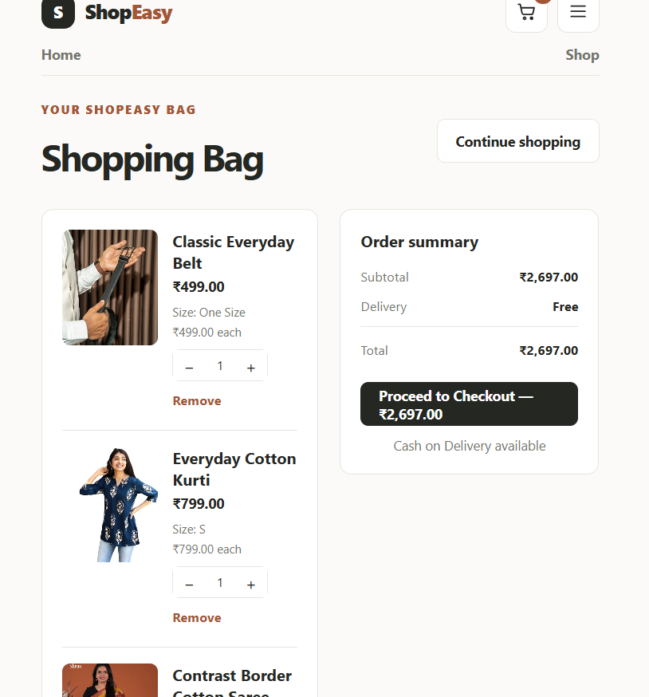

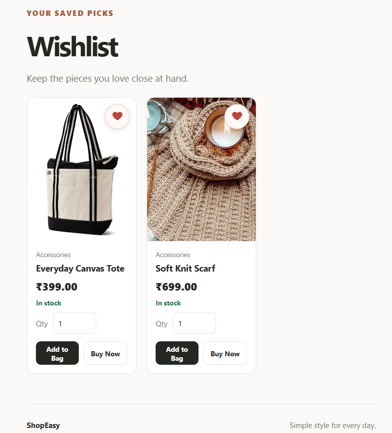

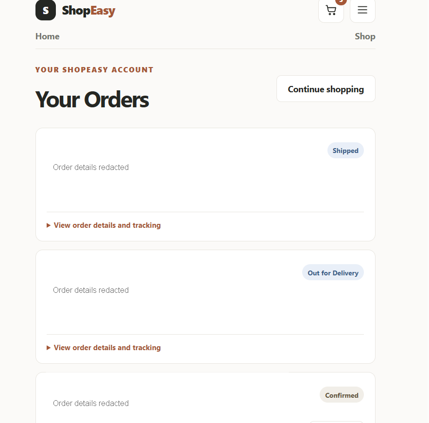

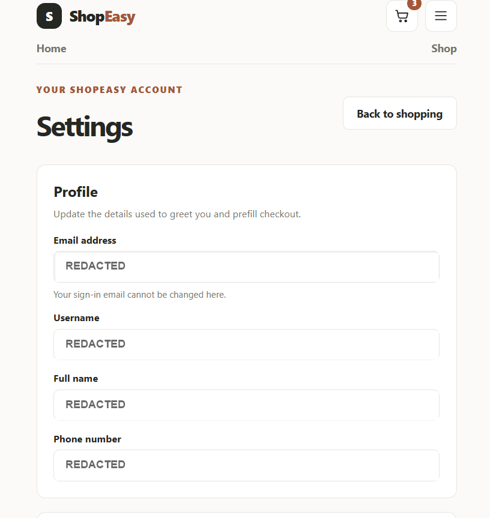

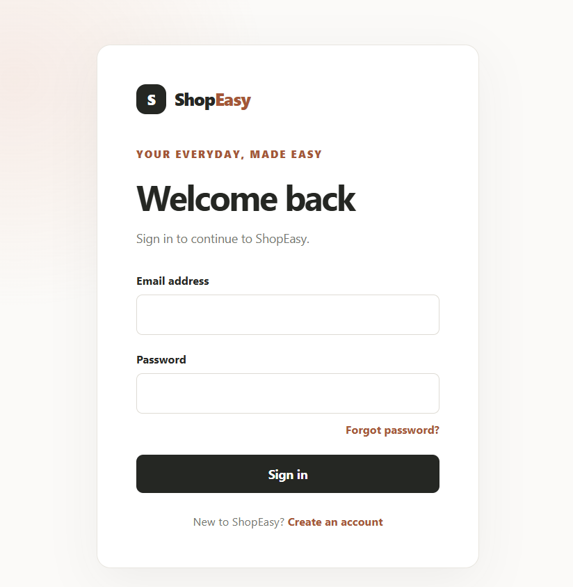

### Admin

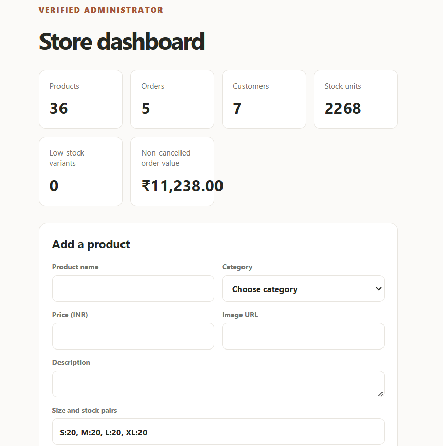

## ER diagram

The schema-aligned diagram source is [`docs/ER-diagram.mmd`](./docs/ER-diagram.mmd).
User profile fields are stored in Supabase Auth user metadata; there is no
separate ShopEasy profile table. The diagram below shows the repository-defined
application tables and their foreign-key relationships. It describes the
checked-in schema, not a verified live database export.

The [supplied ER diagram image](./docs/diagrams/ER-diagram-draft.png) is also
kept in a separate diagrams folder as a draft. It does not match the checked-in
database schema (for example, it includes a `USERS` table and omits wishlist,
product variants, and order-status history), so use the Mermaid diagram below
and `supabase/schema.sql` as the submission reference.

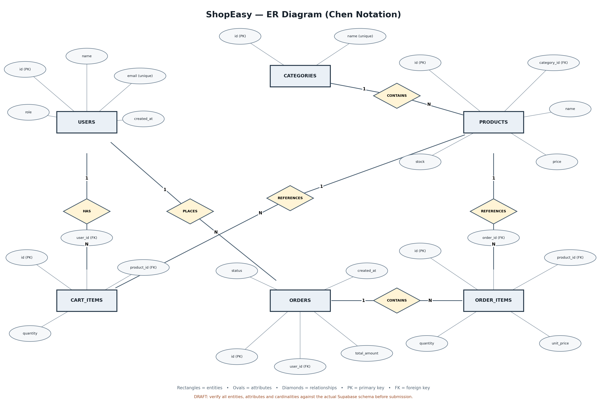

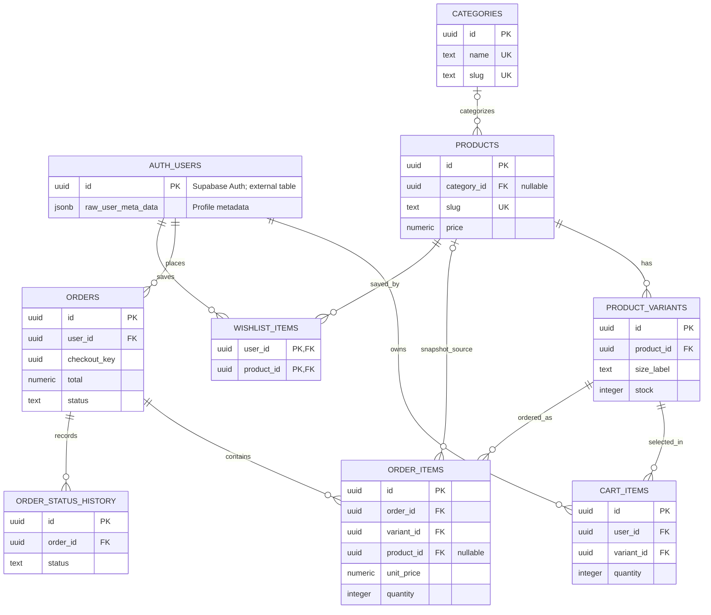

The checked-in `.mmd` file includes the schema's additional columns and
composite-key notes. No Mermaid-to-PNG/PDF renderer is installed in this
workspace; the Mermaid source can be rendered by GitHub Markdown or a
Mermaid-compatible editor.

### Administrator authorization

`public.is_shop_admin()` checks the signed-in Auth user's exact email
(`aryanmajumder8565@gmail.com`) and requires a confirmed email. The function
does not read browser storage or editable profile data. Product writes,
administrator order reads, administrator status updates, and dashboard summary
are protected by RLS and/or database functions that call the same function.
Registration never accepts a role.

The email is an authorization identifier, not a password or an admin bypass.
An evaluator must create or use the corresponding user in the configured
Supabase Auth project and complete any required email confirmation. This
repository does not prove that the account exists in the live project and does
not include or require an admin password.

Product activation and deactivation update the product row directly and request
the changed row as confirmation. PostgreSQL RLS permits the operation only for
the designated verified administrator; ordinary customers cannot activate or
deactivate products.

Customer order queries are scoped to `auth.uid()`. Order creation, cancellation,
cart mutation, and admin status progression run through `SECURITY DEFINER`
PostgreSQL functions with fixed search paths. Cancellation locks the owned
order row, checks that its status is `placed` or `confirmed`, restores every
variant quantity, and changes the status in one transaction. A repeat request
fails after the first state change, so inventory is not restored twice.
Checkout prices are read from current product rows and copied to immutable
order-item snapshots. A per-user checkout key prevents duplicate order
creation after a retry.

The admin sales statistic is the sum of order totals whose current status is
not `cancelled`; because the shop is COD, it is labelled **Non-cancelled order
value**, not settled payment revenue.

### Customer settings

Customers can update their username, full name, phone number, delivery address,
city, PIN code, and notification preferences from **Settings**. These values
are saved to the signed-in user's Supabase Auth metadata; the email shown there
is read-only. Profile and saved delivery details prefill checkout and can be
edited before an order is placed. Notification choices are stored, but the app
does not currently send order-update or product-news emails. These editable
profile fields are never used to authorize admin access.

### Supabase Auth settings

Set Site URL to `http://127.0.0.1:5173` and add
`http://127.0.0.1:5173/**` to Redirect URLs when running Vite with
`--host 127.0.0.1`. For a hosted site, also add its deployed URL and
`https://your-site.example/**` to Redirect URLs. Registration confirmation
returns to the same site at `/login`; password recovery returns to
`/reset-password`. Both paths must be allowed for the site you use. Keep the
dev server running while opening local email links.

### Password recovery

On the sign-in page, choose **Forgot password?**, enter the account email, and
open the Supabase email link. Choose and confirm a new password on the reset
page, then sign in with it. Passwords are changed through Supabase Auth; the
application never stores passwords itself.

## Customer flow test

1. Register/sign in using Supabase Auth. Confirm the email if confirmation is
   enabled.
2. Open **Explore the shop**. The page reads active categories, products, and
   size-specific variant stock from Supabase. Use the heart on a product to add
   it to your saved wishlist, then open **Wishlist** from the account menu.
3. Select a collection, search/sort, choose an in-stock size and quantity, and
   click **Add to Bag**. Use the header bag icon to check the saved item and
   quantity. The count reloads on refresh and updates after cart mutations.
4. Change quantity/remove an item and check that line totals and subtotal
   update. Delivery is free; the only payment option is COD.
5. For an individual **Buy Now**, test with items already in the bag: checkout
   must show only the chosen item and leave the saved bag unchanged. If signed
   out, the checkout URL's variant and quantity are preserved across login.
6. Submit valid shipping details. Verify one `placed` COD order appears in
   **Your Orders**, item snapshots and price total are correct, variant stock
   is reduced, and cart-based checkout clears the bag.
7. Refresh and verify cart/order data remains. The order timeline reads saved
   status history, not frontend-only statuses.
8. Cancel a `placed` or `confirmed` order and verify status becomes `cancelled`
   and stock is restored once. Repeat the RPC call; it must fail without a
   second stock increase. Cancellation is unavailable after `packed`.

   Order statuses progress automatically: orders are confirmed 5 minutes after
   placement if the admin has not confirmed them, packed 30 minutes after
   confirmation, and shipped 4 hours after packing. The admin can still manually
   confirm or advance orders at any time. Customer and admin order pages refresh
   automatically every minute while open.

## Administrator flow test

1. Sign in using the verified designated administrator account.
2. Open `/admin`. If `is_shop_admin()` or the schema migration has not been
   applied, the dashboard must fail closed.
3. Add/update products and adjust stock. Active and deactivated products appear
   in separate lists; use **Reactivate** in the deactivated list to return a
   product to the shop. Add/edit/remove categories. Removing a category sets its
   product category to null; it does not delete those products.
4. Advance an order one step at a time through Confirmed, Packed, Shipped,
   Out for Delivery, and Delivered. The database function rejects skipped
   transitions and cancelled orders.
5. Sign in as an ordinary customer and verify `/admin` refuses access and RLS
   prevents querying another customer's orders.
6. Apply the auto-progression migration in the development database and verify
   its `pg_cron` job advances a test order at the configured delays. Manual
   admin confirmation remains available; verify the scheduled job in Supabase
   rather than assuming the migration ran.

## Project structure

```text
src/
  auth/                         Auth state and hook
  components/                   Product imagery and cards
  context/                      Wishlist state
  lib/                          Supabase client and shop formatting
  pages/                        Shop, detail, bag, checkout, orders, admin
  App.jsx                       Protected routes and shared header
supabase/
  migrations/                   Admin, schema/RPC/RLS, wishlist, and cron job
  schema.sql                    Consolidated migration snapshot for clean dev
  seed.sql                      Seven categories and 36 sample products
docs/
  SUBMISSION-AUDIT.md
  API-documentation.md
  ER-diagram.mmd
  diagrams/                      Supplied ER diagram draft image
  postman/                      Collection and placeholder environment
screenshots/
  README.md                     Remaining screenshot capture checklist
  captures/                      Supplied, privacy-redacted PNG screenshots
```

## Known limitations and verification boundary

Order status is application-managed and scheduled; no courier/carrier tracking
is integrated. Checkout is Cash on Delivery only; there is no payment gateway
or settlement integration. Notification preferences are stored, but order or
product emails are not sent. Browsing is sign-in gated. The repository has no
test suite or type-check script.

The checked-in SQL describes the repository's intended schema, not a verified
live database dump. Live migrations, policies, Auth email/redirect settings,
admin account, environment variables, and cron job were not checked from this
workspace. Apply and test SQL only in a clean development Supabase project
first. `npm run build` and `npm run lint` validate frontend code only.
